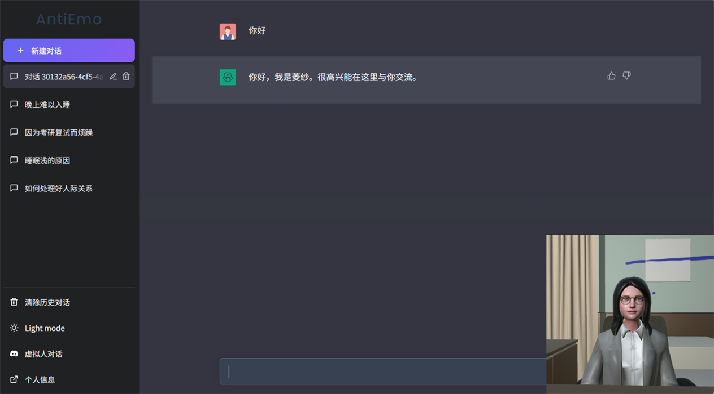

<h1 align="center">Hi there 👋 I'm Fan Bingyang</h1>

  <b>范柄阳</b> · M.S. student in Software Engineering at <a href="https://www.nankai.edu.cn">Nankai University</a>

  <em>Multimodal Large Language Models · AI Agents · Full-Stack Engineering</em>

  
  
  

---

## 👨‍💻 About Me

- 🎓 Currently pursuing a master's degree in **Software Engineering** at **Nankai University**.
- 🧠 Working on **Software Engineering, Multimodal Large Language Models, and AI Agents**.
- 🧩 I enjoy turning ideas into complete systems — from **model fine-tuning** to **front-end & back-end engineering**.
- 📫 How to reach me: **575552896@qq.com**

## 🩺 Featured Project

<table>
<tr>
<td width="53%" valign="top">

### AntiEmo · 基于情感智能的虚拟医生心理咨询系统

<i>An emotionally intelligent virtual doctor for psychological counseling</i>

  

A full-stack AI counseling system where a **LoRA-fine-tuned Qwen2.5-7B** talks like a therapist, **VITS** gives it a voice, and a **Unity 3D digital human** reacts to the user's emotions in real time.

- 🧠 **Model** — LoRA fine-tuning on ~1.5k counseling dialogues (~7k turns)
- 🗣️ **Speech** — VITS fine-tuned on ~70 clean voice clips for a custom timbre
- 🎭 **Avatar** — Blender rigging + Unity WebGL digital human
- 😊 **Emotion** — sentiment API drives the avatar's facial expressions
- ⚙️ **Engineering** — Vue 2 · FastAPI · MongoDB · token-based auth

 

 

</td>
<td width="47%">
  
</td>
</tr>
</table>

  
  

> 💡 **How it works**: user input → emotion analysis → fine-tuned LLM generates a counseling reply → VITS synthesizes speech → Unity digital human plays lip-sync and expression → history stored in MongoDB.

## 🛠️ Technology Stack

## 🔬 Research Interests

- Multimodal Large Language Models
- AI Agents and Long-Term Memory
- Multimodal In-Context Learning
- Retrieval-Augmented Generation

## 🌱 Currently Working On

- Building intelligent AI Agent applications
- Exploring reliable memory updates for LLM Agents
- Researching multimodal in-context learning
